# Modelos gratis

> Generado con `node tools/gen-models-doc.mjs`. Las miniaturas y la imagen de abajo las saca `tools/automation/gallery.mjs` con la propia app.

## En la galería de la app (26)

Ajustes → Skins → **Galería de modelos gratis** (o clic derecho en la waifu → Skin → Galería). Al pulsar **Usar**, la app descarga el modelo de su repositorio original (con el commit fijado, para que no cambie) y lo abre en el editor 3D o VTuber, que enseña su licencia antes de guardarlo. La app no lleva ningún modelo dentro.

Solo están los que su autoría deja usar a cualquiera **y redistribuir**, o que se bajan del repositorio de quien tiene los derechos. Los Live2D necesitan el Cubism Core (la app lo descarga la primera vez, con su licencia).

| | Modelo | Tipo | Autoría | Licencia | Origen |
| --- | --- | --- | --- | --- | --- |
| 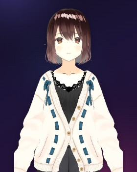 | **AvatarSample A** | 3D · VRM | pixiv (VRoid Studio) | Muestra de VRoid: uso libre | [madjin/vrm-samples](https://github.com/madjin/vrm-samples) |
| 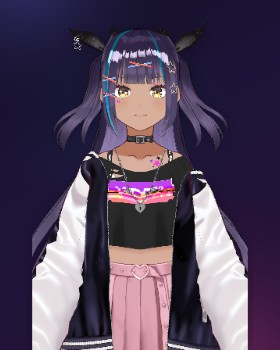 | **AvatarSample B** | 3D · VRM | pixiv (VRoid Studio) | Muestra de VRoid: uso libre | [madjin/vrm-samples](https://github.com/madjin/vrm-samples) |
| 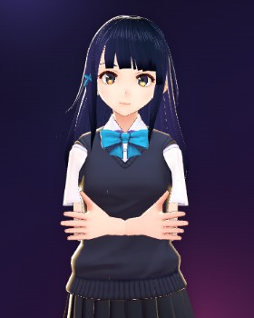 | **Sendagaya Shino** | 3D · VRM | pixiv (VRoid Studio) | CC0 (dominio público) | [madjin/vrm-samples](https://github.com/madjin/vrm-samples) |
| 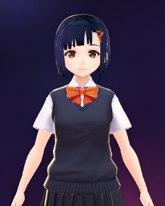 | **Sendagaya Shibu** | 3D · VRM | pixiv (VRoid Studio) | CC0 (dominio público) | [madjin/vrm-samples](https://github.com/madjin/vrm-samples) |
| 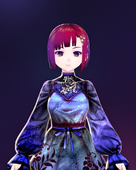 | **Darkness Shibu** | 3D · VRM | pixiv (VRoid Studio) | CC0 (dominio público) | [madjin/vrm-samples](https://github.com/madjin/vrm-samples) |
| 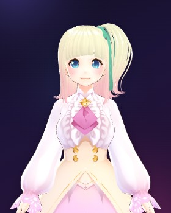 | **Victoria Rubin** | 3D · VRM | pixiv (VRoid Studio) | CC0 (dominio público) | [madjin/vrm-samples](https://github.com/madjin/vrm-samples) |
| 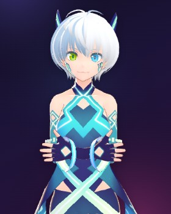 | **Vita** | 3D · VRM | pixiv (VRoid Studio) | CC0 (dominio público) | [madjin/vrm-samples](https://github.com/madjin/vrm-samples) |
| 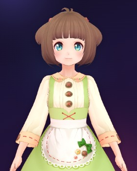 | **Vivi** | 3D · VRM | pixiv (VRoid Studio) | CC0 (dominio público) | [madjin/vrm-samples](https://github.com/madjin/vrm-samples) |
| 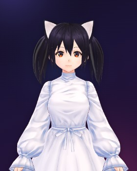 | **HairSample Female** | 3D · VRM | pixiv (VRoid Studio) | CC0 (dominio público) | [madjin/vrm-samples](https://github.com/madjin/vrm-samples) |
| 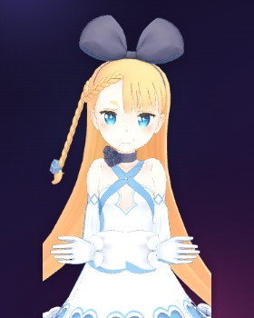 | **Alicia Solid** | 3D · VRM | DWANGO Co., Ltd. | Condiciones de Alicia Solid: sin uso sexual ni violento | [vrm-c/UniVRM](https://github.com/vrm-c/UniVRM) |
| 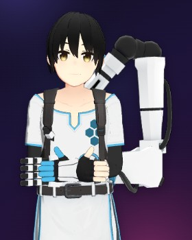 | **Seed-san** | 3D · VRM | VirtualCast, Inc. | VRM Public License 1.0 · pide crédito | [vrm-c/vrm-specification](https://github.com/vrm-c/vrm-specification) |
| 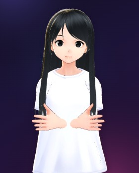 | **three-vrm girl** | 3D · VRM | pixiv Inc. | VRoid Hub: también uso comercial | [pixiv/three-vrm](https://github.com/pixiv/three-vrm) |
| 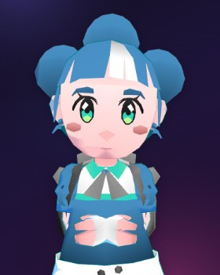 | **Godette (low-poly)** | 3D · VRM | SirRichard94 · Lyuma | CC BY 3.0 · pide crédito | [V-Sekai/godot-vrm](https://github.com/V-Sekai/godot-vrm) |
| 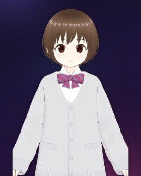 | **N.E.K.O Sister** | 3D · VRM | 八黑山 | VRM Public License 1.0 | [Project-N-E-K-O/N.E.K.O](https://github.com/Project-N-E-K-O/N.E.K.O) |
| 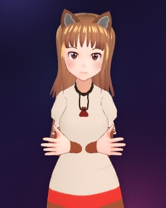 | **Holo** | 3D · VRM | H. NOMATA | VRoid Hub: uso personal, no comercial | [webaverse/avatar-models](https://github.com/webaverse/avatar-models) |
| 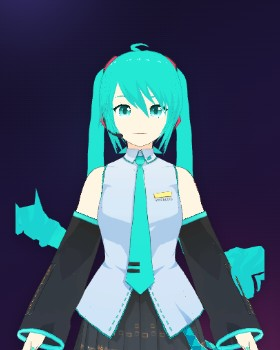 | **Hatsune Miku (LS)** | 3D · VRM | lente · illuminance | VRoid Hub: uso personal, no comercial | [webaverse/avatar-models](https://github.com/webaverse/avatar-models) |
| 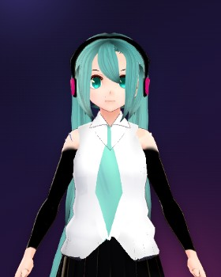 | **Hatsune Miku (Kasumi)** | 3D · VRM | Kasumi | VRoid Hub: también uso comercial | [webaverse/avatar-models](https://github.com/webaverse/avatar-models) |
| 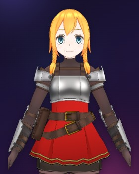 | **Ruike** | 3D · VRM | quappa-el | VRoid Hub: también uso comercial · pide crédito | [webaverse/avatar-models](https://github.com/webaverse/avatar-models) |
| 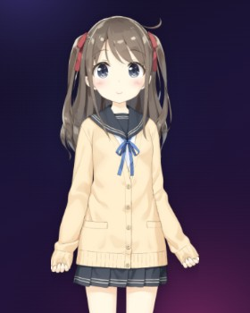 | **Hiyori Momose** | VTuber · Live2D | Live2D Inc. | Live2D Free Material License | [Live2D/CubismWebSamples](https://github.com/Live2D/CubismWebSamples) |
| 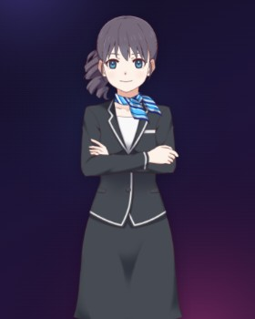 | **Haru** | VTuber · Live2D | Live2D Inc. | Live2D Free Material License | [Live2D/CubismWebSamples](https://github.com/Live2D/CubismWebSamples) |
| 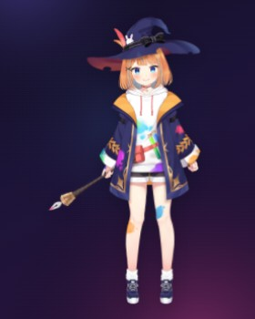 | **Mao Niziiro** | VTuber · Live2D | Live2D Inc. | Live2D Free Material License | [Live2D/CubismWebSamples](https://github.com/Live2D/CubismWebSamples) |
| 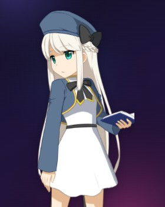 | **Rice Glassfield** | VTuber · Live2D | Live2D Inc. | Live2D Free Material License | [Live2D/CubismWebSamples](https://github.com/Live2D/CubismWebSamples) |
| 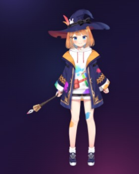 | **Mao (4K)** | VTuber · Live2D | Live2D Inc. | Live2D Free Material License | [Open-LLM-VTuber/Open-LLM-VTuber](https://github.com/Open-LLM-VTuber/Open-LLM-VTuber) |
| 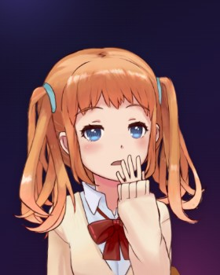 | **Shizuku** | VTuber · Live2D | Live2D Inc. | Live2D Free Material License | [Open-LLM-VTuber/Open-LLM-VTuber](https://github.com/Open-LLM-VTuber/Open-LLM-VTuber) |
| 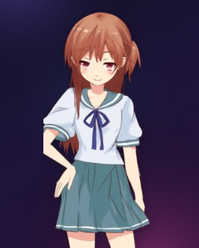 | **Hibiki** | VTuber · Live2D | Live2D Inc. | Live2D Free Material License | [Ikaros-521/AI-Vtuber](https://github.com/Ikaros-521/AI-Vtuber) |
| 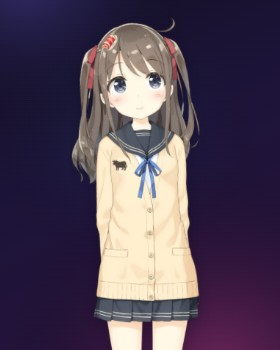 | **Hiyori · Feiniu** | VTuber · Live2D | Live2D Inc. · my-neuro | Live2D Free Material License | [morettt/my-neuro](https://github.com/morettt/my-neuro) |

## Solo en la imagen (13)

Modelos gratuitos que se pueden usar como avatar pero cuya licencia **no deja redistribuirlos**, así que la app no los ofrece. Si quieres usar alguno, búscalo en su origen (VRoid Hub, el repositorio indicado) y respeta sus condiciones.

| | Modelo | Tipo | Autoría | Licencia | Origen |
| --- | --- | --- | --- | --- | --- |
|  | **Noa 3D (de serie)** | 3D · VRM | pixiv Inc. | VRM Public License 1.0 · ya viene con la app | [pixiv/three-vrm](https://github.com/pixiv/three-vrm) |
|  | **Miko (AITuber OnAir)** | 3D · VRM | AITuber OnAir | Uso libre, sin redistribuir ni uso sexual | [shinshin86/aituber-onair](https://github.com/shinshin86/aituber-onair) |
|  | **Scillia** | 3D · VRM | GloriaTheAnimator | Uso personal no comercial, sin redistribuir | [webaverse/app](https://github.com/webaverse/app) |
|  | **Pelo azul** | 3D · VRM | VRoid Hub | VRoid Hub: comercial, sin modificar · no redistribuible | [webaverse/avatar-models](https://github.com/webaverse/avatar-models) |
|  | **Monja pagana** | 3D · VRM | VRoid Hub | VRoid Hub: no comercial, sin modificar · no redistribuible | [webaverse/avatar-models](https://github.com/webaverse/avatar-models) |
|  | **Capucha gris** | 3D · VRM | VRoid Hub | VRoid Hub: no comercial, con crédito · no redistribuible | [webaverse/avatar-models](https://github.com/webaverse/avatar-models) |
|  | **Pelo castaño** | 3D · VRM | VRoid Hub | VRoid Hub: no comercial, con crédito, sin modificar · no redistribuible | [webaverse/avatar-models](https://github.com/webaverse/avatar-models) |
|  | **Pelirroja** | 3D · VRM | VRoid Hub | VRoid Hub: no comercial, con crédito, sin modificar · no redistribuible | [webaverse/avatar-models](https://github.com/webaverse/avatar-models) |
|  | **Yagami Yato** | 3D · VRM | VRoid Hub | VRoid Hub: con crédito, sin modificar · no redistribuible | [webaverse/avatar-models](https://github.com/webaverse/avatar-models) |
|  | **Pelo negro** | 3D · VRM | VRoid Hub | VRoid Hub: no comercial, con crédito · no redistribuible | [webaverse/avatar-models](https://github.com/webaverse/avatar-models) |
|  | **Coleta** | 3D · VRM | VRoid Hub | VRoid Hub: comercial · no redistribuible | [webaverse/avatar-models](https://github.com/webaverse/avatar-models) |
|  | **Miku azul** | 3D · VRM | VRoid Hub | VRoid Hub: no comercial · no redistribuible | [webaverse/avatar-models](https://github.com/webaverse/avatar-models) |
|  | **Pelo rosa** | 3D · VRM | VRoid Hub | VRoid Hub: no comercial, con crédito · no redistribuible | [webaverse/avatar-models](https://github.com/webaverse/avatar-models) |

## Resumen de licencias

- **CC0**: dominio público, sin condiciones.
- **Muestras de VRoid** (AvatarSample A y B): uso libre según las [condiciones de VRoid](https://vroid.pixiv.help/hc/en-us/articles/4402614652569).
- **VRM Public License 1.0** ([texto](https://vrm.dev/licenses/1.0/)): lo que declare cada modelo en su ficha (el editor de la app lo enseña).
- **Alicia Solid**: [condiciones de DWANGO](https://3d.nicovideo.jp/alicia/rule.html); nada de uso sexual ni violento.
- **CC BY 3.0** (Godette): hay que citar la autoría.
- **VRoid Hub**: cada modelo dice si permite uso comercial, modificarlo, redistribuirlo y si pide crédito.
- **Live2D Free Material License** ([texto](https://www.live2d.com/eula/live2d-free-material-license-agreement_en.html)): uso libre para particulares y empresas pequeñas; Shizuku hay que usarla con su nombre y personalidad.

## Más modelos sin crear cuenta

- [Muestras oficiales de Live2D](https://www.live2d.com/en/learn/sample/): Miara, Tsumiki, Izumi, Koharu, Epsilon, Kei… (Download tras aceptar la licencia). El .zip se importa tal cual.
- [Modelos VRoid CC0 en OpenGameArt](https://opengameart.org/content/vroid-studio-cc0-models).
- itch.io: en los de «name your own price», **Download Now → No thanks, just take me to the downloads**. Por ejemplo [式神 COLLECTION](https://karindou.itch.io/vroid) (4 VRM CC0), [Alice Chan](https://yuna0x0.itch.io/alice-chan) (CC BY-SA), [Kotori](https://fox-jump.itch.io/kotori-anime-character) y [Kaya](https://fox-jump.itch.io/kaya-anime-character).
- Hazte la tuya gratis con [VRoid Studio](https://vroid.com/studio) y expórtala a VRM.
- Con cuenta: [VRoid Hub](https://hub.vroid.com), [Booth](https://booth.pm) y [nizima](https://nizima.com) tienen muchos más.

No valen los modelos de Cubism 2 (`model.json` + `.moc`) ni los exportados para Cubism 5.3. Evita los repositorios con cientos de modelos «Live2D» sacados de juegos: no tienen licencia.
